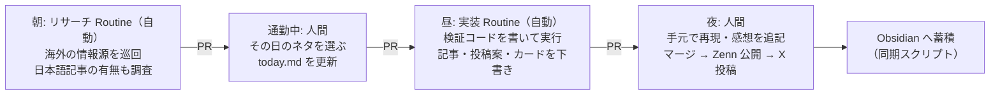

# ai-100days — 海外AIネタ100日チャレンジ

> 海外で話題の AI 関連ニュース・OSS・論文を **毎日1件見つけて実際に動かし**、日本語で発信する。

| 項目 | 内容 |
|---|---|
| リポジトリ | [Matsushima-A-830/ai-100days](https://github.com/Matsushima-A-830/ai-100days)（Public） |
| 期間 | 2026-09-28 開始 → 継続中（2026-11-23 時点で **Day 056**） |
| マージ済み PR | 192 |
| 成果物（1日ごと） | 検証コードと実行ログ / Zenn 記事 / X 投稿案 / note 原稿 / X 用シェアカード / 解説動画 |
| 検証環境 | クラウド（Claude Code Routines）+ ローカル PC（WSL2 / RTX 5060 Ti 16GB） |

---

## 仕組み: 自動化と人間の役割分担

- **公開判断とマージは必ず人間が行う。** Routine は `published: false` の下書きまでしか作らない
- **main への直接 push は所有者・AI を問わず一切禁止**（ブランチ保護で管理者にも適用）
- 毎日の作業をすべて PR 単位にすることで、「AI が作った下書き」と「人間が確認した完成版」の差分が履歴に残る

## 検証の信頼性ルール

AI に検証させる以上、「それっぽい記事」になるリスクがあります。そこで次をルールとして明文化しました。

| ルール | 理由 |
|---|---|
| **動かしていないものを「動いた」と書かない。** 実行ログ・エラーは `results.md` にそのまま残す | 失敗ログもコンテンツになる |
| 失敗を「検証対象の失敗」と「自動実行環境の制約による失敗」に分ける。後者は記事に書かず、ローカル検証にエスカレーションする | 読者の環境で起きない失敗を、ツールの欠点として書かないため |
| 出典 URL・ライセンスを必ず明記する | 転載ではなく自分の検証結果を主役にする |
| 候補を選ぶ前に Zenn / Qiita / note で **日本語記事の件数を調べる** | 日本語で未発信のものを優先し、発信の価値を出す |
| 6時間以内に検証できるもの、有料 API キー不要のものを選ぶ | 「1日1検証」を継続可能にする |

---

## 代表的な検証

公式の主張を鵜呑みにせず、実際に動かして **主張と実態の差** を確かめた回が中心です。

| Day | テーマ | わかったこと |
|---|---|---|
| 005 | 「4GB GPU で 8B モデルを学習できる」という OSS の主張 | 学習は本当に動いたが、**出力されたアダプタが空** だった |
| 014 | ライセンス不明の OSS をローカル GPU で | 記事化は見送り。Blackwell GPU で動かない問題は推論エンジンへの小さなパッチで解消 |
| 020 | SAE（スパースオートエンコーダ）の特徴は足し算できるか | 論文の指標を GPT-2 Small で再現 |
| 025 | エージェントの記憶を KV キャッシュの直接操作で圧縮できるか | 135M モデルで試行。→ [forget-bench](./forget-bench.md) の KV 層の実装に発展 |
| 033 | Ollama 公式の低ビット量子化タグ | ダウンロードもロードもできるのに **0問しか解けない** タグがあることを、データの再集計で確認 |
| 045 | 重みの 0.05% を消すだけでファインチューニング相当になるか | 公開マスクを実際に適用して検証 |
| 051 | 「3090 で約2.3時間」の 64M LLM 自作 | RTX 5060 Ti で公式手順どおりに事前学習〜SFT |
| 056 | 「100行の AI エージェント」にローカル LLM で1行のバグを直させる | **27回中4回** しか直らなかった |

公開先: [Zenn](https://zenn.dev/matsushima_a)（技術記事） / [note](https://note.com/regal_poppy7370)（経緯・振り返り）

---

## この活動で身についたこと

- **新しい技術を短時間で動かす力。** 毎日異なる OSS・論文を、環境構築から結果の整理まで1日で回す
- **ローカル GPU 環境の運用。** CUDA / Blackwell 世代特有の互換問題、VRAM 16GB に収める工夫
- **LLM を業務フローに組み込む設計。** 自動化する範囲と人間が判断する範囲の線引き、品質ルールのプロンプト化
- **技術を言語化して伝える力。** 同じ検証を、技術記事（Zenn）・ストーリー（note）・短文（X）・動画に書き分ける
