# ミツカフェ（cafe_sns_site）— ケーススタディ

> **「気分で見つかる、行きつけと繋がる」— カフェ好きのためのSNS**

| 項目 | 内容 |
|---|---|
| 役割 | 個人開発（企画・戦略・設計・実装・テスト・運用をすべて担当。実装は Claude Code と協働） |
| 期間 | 2026-09-03 着手 → 継続中 |
| 状況 | 全37画面を実装済み。**招待制の検証ベータとして本番稼働中** |
| ターゲット | メイン: 日本の10〜20代のカフェ好き ／ サブ: 個人経営のカフェオーナー |
| リポジトリ | 非公開（このページで設計と判断を公開。選考時は画面共有で説明可能） |

## 画面

> ローカル環境のテストデータで撮影。開発用ツールの表示と住所を加工で消しています。

### ホーム — 「今、どんなカフェ気分？」から始まる
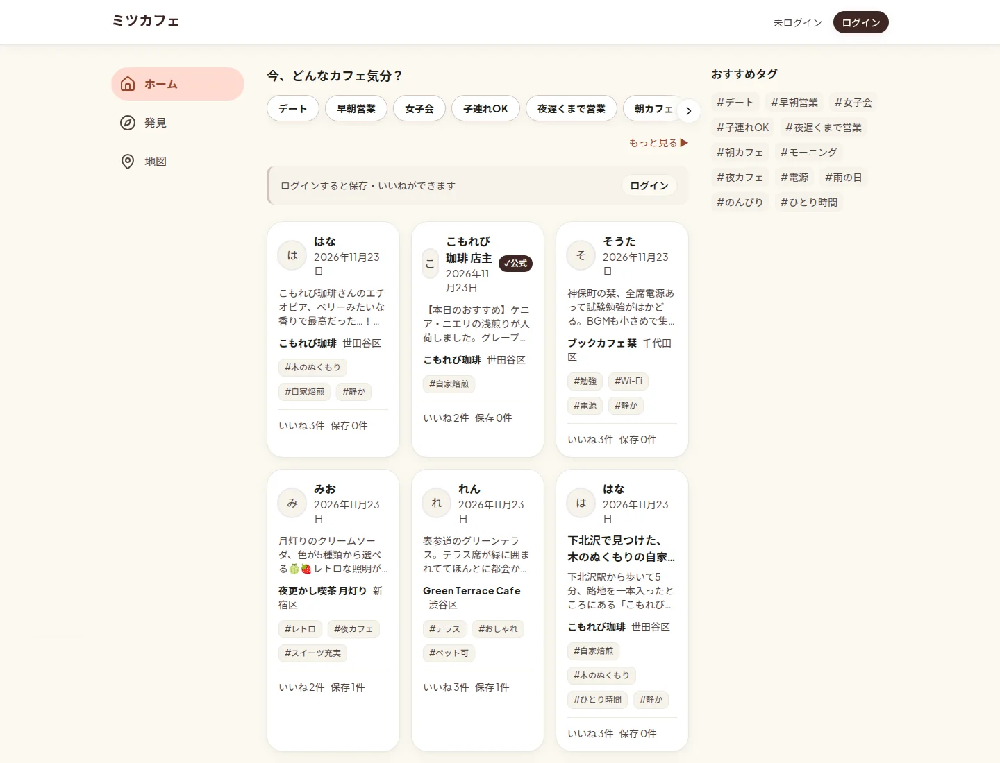

### スマホ表示

| ホーム（未ログイン） | ホーム（ログイン後） | カフェ詳細 | オーナーダッシュボード |
|---|---|---|---|
| 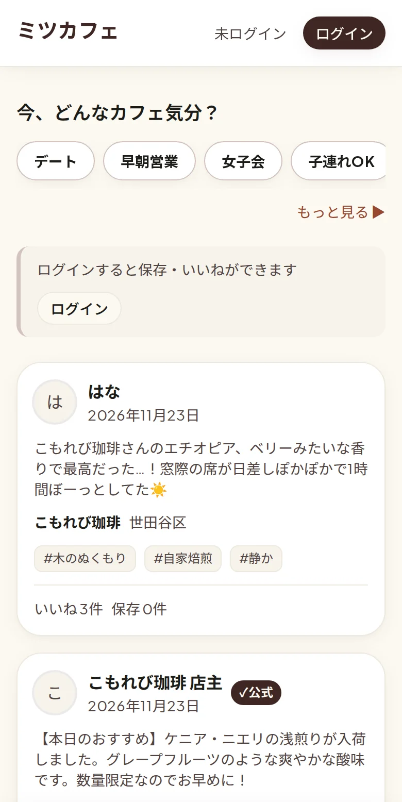 | 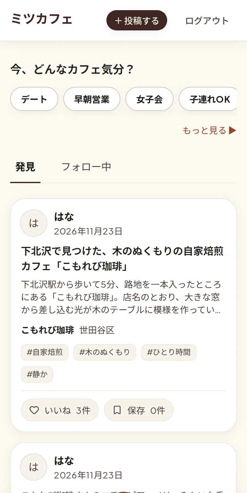 | 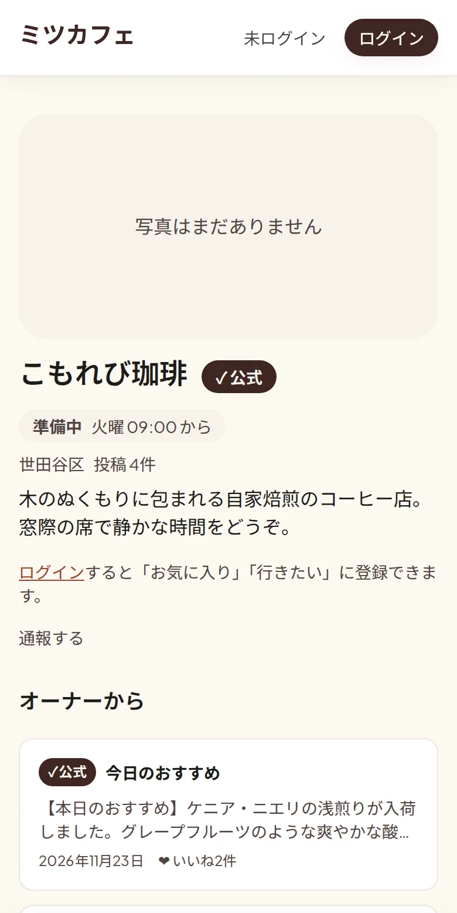 | 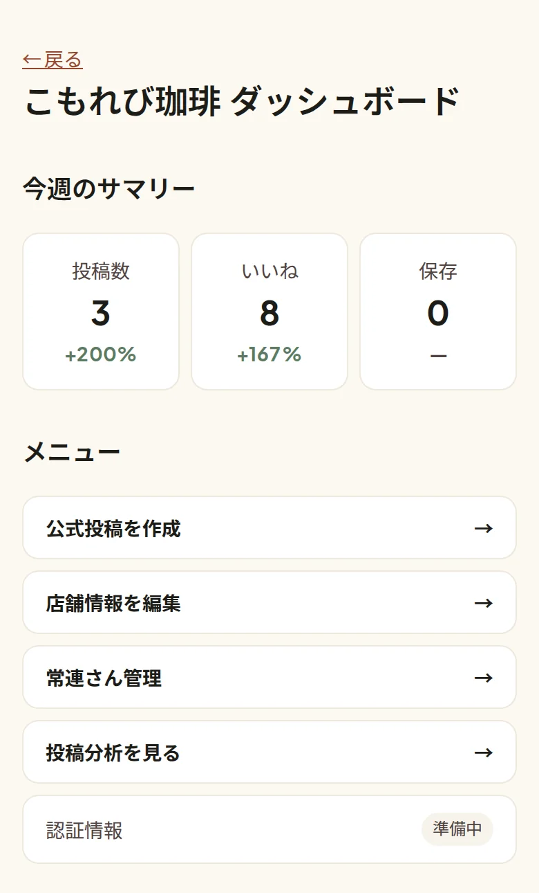 |

### カフェ詳細 — オーナー公式投稿・営業時間・地図・混雑度
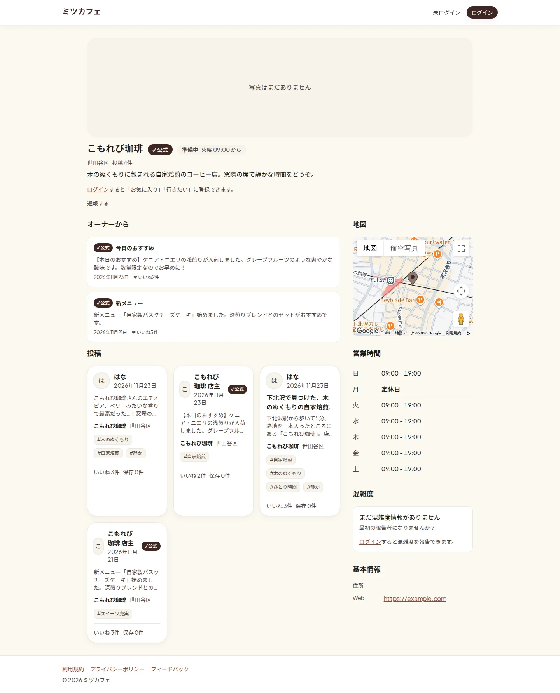

### 地図から探す — エリア・雰囲気・利用機会で絞り込み
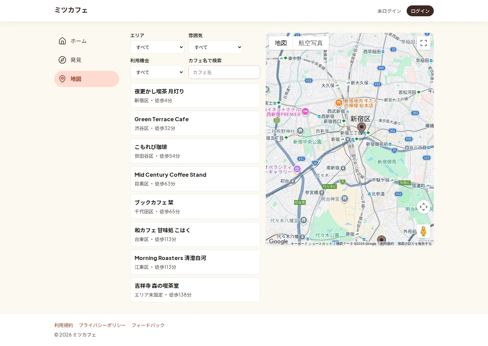

### ブログ投稿 — Tiptap によるリッチテキスト
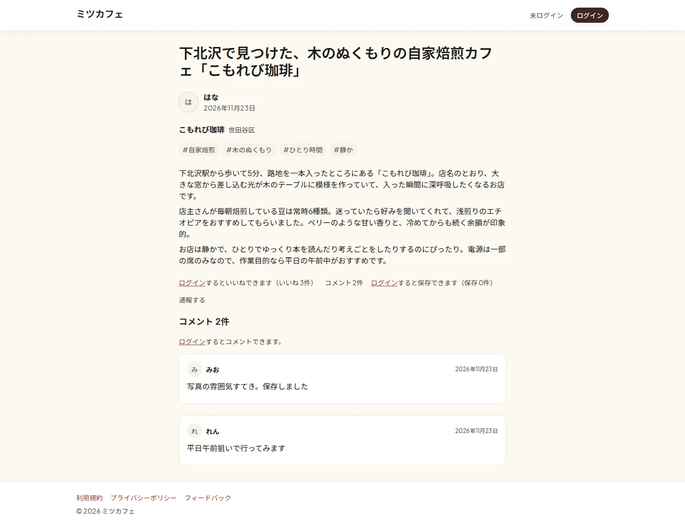

### オーナー向け — ダッシュボードと投稿分析

| ダッシュボード | 投稿分析 |
|---|---|
| 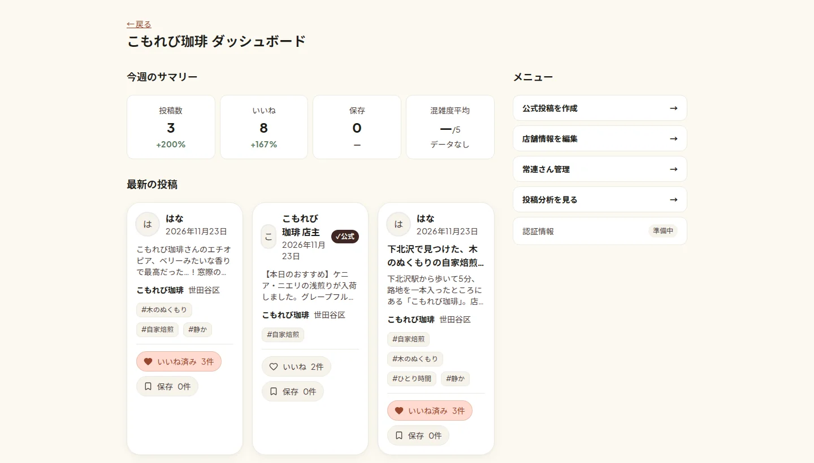 | 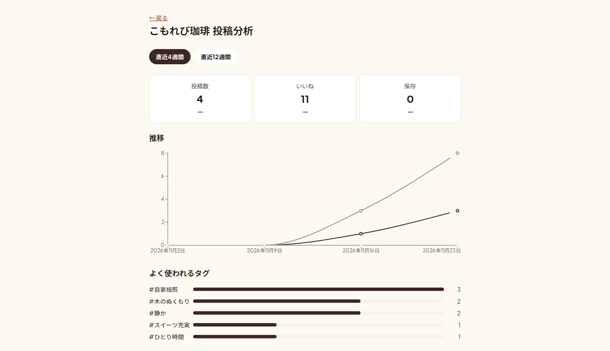 |

### バッジ — シーン開拓などのゲーミフィケーション
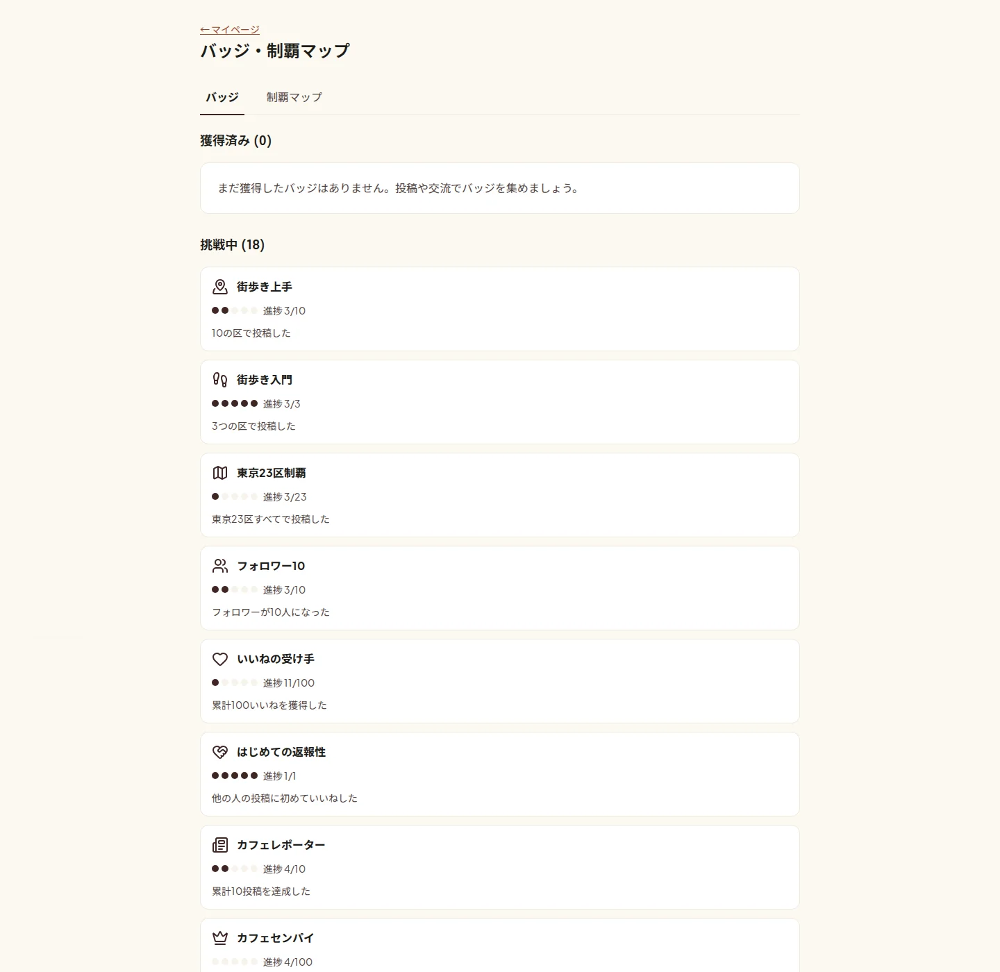

---

## 1. プロダクト戦略

### 解きたい課題
Instagram でカフェを探すと、「映える写真」と「フォローの近況」が中心になります。
しかし実際にカフェを選ぶときの動機は「今日はひとりで集中したい」「雨の日にのんびりしたい」といった **気分・シーン** です。
また個人経営のカフェにとって、汎用SNSは広告色が強く、**常連との関係を育てる場** になっていません。

### 差別化の2つの幹
すべての機能判断はこの2本に立ち返るようにしました（設計ドキュメント `positioning.md` を判断の起点として固定）。

| 幹 | コンセプト | 主な施策 |
|---|---|---|
| **A: 気分・シーン起点の発見** | 「今こういうカフェに行きたい」から最短で出会える | ホーム最上部の「今、どんなカフェ気分？」入り口 / シーンタグを最優先表示 / 好きな気分をオンボーディングで必須選択 / シーン開拓バッジ |
| **C: オーナーとの信頼つながり** | 個人カフェと客が直接つながり、行きつけを深める | 経営者認証バッジ / オーナー限定投稿フォーマット（今日のおすすめ・臨時休業 等） / 常連認定 / オーナー公式返信 / 常連分析ダッシュボード |

### 「やらないこと」を決めた
フォロー中心のフィード、映え用の写真フィルタ、ストーリーズ的な短時間コンテンツ、DM、アフィリエイト誘導。
差別化の軸とぶつかる機能は、競合に寄せるほど埋もれるため明文化して切りました。

### 行動経済学を UI に落とす

| 要素 | 実装 |
|---|---|
| 損失回避 | ブログ投稿の下書きを15秒デバウンスで自動保存 + 離脱前アラート |
| デフォルト効果 | 投稿時のタグを位置情報から自動サジェスト |
| 選択のパラドックス回避 | 厳選タグを30個に絞る / デフォルトソートは「おすすめ」 |
| ゲーミフィケーション | 20種のバッジ、エリア制覇（東京45エリア） |
| ピークエンド則 | 投稿完了時のマイクロアニメーション |

### 若年層向けの安全設計
メインターゲットに未成年が含まれるため、MVP の段階から次を必須にしました。
- 生年月日の入力必須。13歳未満は登録不可、13〜17歳は **保護者同意メールのフロー** を経て有効化
- 通報・ブロック・NGワード、管理者の通報キュー（投稿・カフェの非表示判定）
- **画像の EXIF（位置情報）除去**。自宅や学校の周辺が特定されるリスクを防ぐ（[後述](#exif除去をクライアントに任せない)）

---

## 2. アーキテクチャ

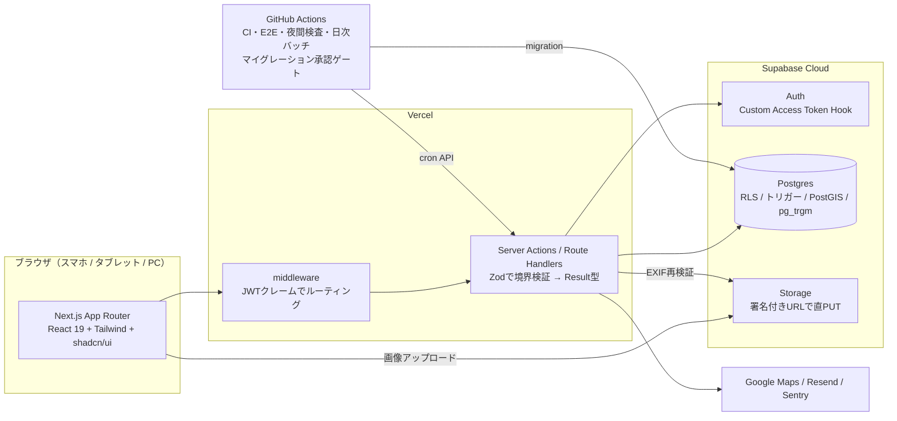

### 主な設計判断

| 判断 | 理由 |
|---|---|
| **認可は RLS に集約**し、アプリ層には書かない | 認可の抜けを1か所で塞げる。Server Actions は入力検証だけに責務を絞る。全27テーブルで RLS を有効化（ポリシー100超） |
| Supabase クライアントは **薄いラッパー越し** に使う | 将来の AWS 移行に備え、ストレージ等の依存を `lib/` の境界に閉じ込める |
| エラーは **Result 型 + エラーカタログ** | `{ ok: false, error: 'CODE' }` で返し、コードはカタログに登録必須。UI メッセージはフロント側で変換し、勝手な文字列の発明を防ぐ |
| 全文検索は `simple` tsvector + **pg_trgm** | 日本語の部分一致は pg_trgm が担う。PGroonga はマネージド環境での導入コストに見合わないと判断し、精度が課題化したら張り替える方針 |
| カウンタ（いいね数等）は **トリガーで非正規化** | 一覧での N+1 を避ける |
| **論理削除** を基本にする | 通報・監査のために履歴を残す |
| 環境は Local / Preview / Production の3つ、staging は省略 | Preview デプロイで代替でき、個人 MVP には過剰 |

---

## 3. 規模

| 指標 | 値 |
|---|---|
| 画面（設計 / 実装） | 37 / 37 |
| テーブル / マイグレーション | 27 / 74 |
| TypeScript | 約 60,000 行 |
| SQL（マイグレーション） | 約 5,900 行 |
| テストファイル | 184（統合 49 / E2E 26 / 残りはユニット・コンポーネント） |
| マージ済み PR | 144 |
| 設計ドキュメント | 約 11,600 行 |

---

## 4. 品質を守る仕組み

### テストは3層
| 層 | ツール | 対象 |
|---|---|---|
| ユニット / コンポーネント | Vitest + React Testing Library | バリデーション、Server Actions（Supabase クライアントを DI してテスト可能に） |
| 統合 | Vitest + ローカル Supabase | **RLS が実際に弾くか**、トリガー、RPC |
| E2E | Playwright | 主要導線。全画面を実機で触って確認し、1〜2本を spec に落とす運用 |

コアロジック（Server Actions・バリデーション・DB）は **テストを先に書く**（Red → Green → Refactor）ことをルールにしています。

### 設計ドキュメントを「正」にする
`docs/` を単一の情報源とし、実装とズレたら **ドキュメントを先に直してから実装** します。
画面ID（`S_HOME` 等）を戦略・ワイヤー・画面遷移・`page.tsx` の冒頭コメントで一貫させ、トレーサビリティを確保しています。
未決事項と決定の経緯は `pending-items.md` に100件以上蓄積しています（選択肢・決定・理由・影響範囲の形式）。

### 機械で止める
| 仕組み | 内容 |
|---|---|
| 独自デザイン Lint | `#000` 系の色、インライン style、8px の倍数でない余白、任意値のフォントサイズを検出。**CI と pre-commit の両方で実行** |
| Biome / tsc strict | `any` 禁止。`unknown` からナローイング |
| commitlint | Conventional Commits（日本語）を強制 |
| マイグレーション検査 | PR でマイグレーションの適用を検証。本番適用は GitHub Environments の **手動承認ゲート** を通す（forward-only） |
| 夜間ジョブ | Safari（WebKit）E2E、スキーマのドリフト検出、実装状況ボードとの差分 |
| Sentry | サーバー側の例外を集約（`console.error` を全面的に移行） |

### CI のコストを実測して削る
無料枠を超えた分の予算（$5 ≒ Linux 625分）に収めるため、ジョブごとの課金分を分単位で実測しました。
- E2E の `push: main` トリガーを外し、WebKit 検証は夜間に集約（マージごとに −11分）
- 夜間ジョブは週1回から開始し、消費量を見てから頻度を決める
- draft PR では AI レビューを走らせない、連続 push では古い run をキャンセル
- 実測で **cron が指定時刻の3時間40分後に発火** したことを確認し、「時刻依存の処理を schedule に置かない」ルールを追加

---

## 5. 技術的に工夫した点

### EXIF除去をクライアントに任せない
画像は署名付き URL でブラウザから Storage へ直接 PUT する構成です。
サーバーがバイト列を見ないため、クライアント側で EXIF を除去しても **改造クライアントやバグで GPS 付き画像が公開バケットに入り得る** ことに気づきました。

| 案 | 評価 |
|---|---|
| a) 投稿確定の直前にサーバーが Storage から読み直して GPS の有無を検証 | **採用**。直 PUT 構成を維持でき、追加コストは1往復のダウンロードだけ |
| b) サーバー経由アップロードに変更 | 帯域・実行時間を消費し、以前の決定を覆す |
| c) 現状維持 | 若年層の位置情報漏洩という実害を許容し続ける |

GPS が検出された画像は即座に削除し、投稿自体を専用エラーコードで拒否します。

### 未成年の保護者同意フローと JWT クレーム
年齢区分・オンボーディング状況・ロールを Supabase の **Custom Access Token Hook** で JWT に載せ、middleware がそれを見てルーティングします。
DB を毎リクエスト引かずに済む一方、「JWT は発行時点の内容を保持する」性質による落とし穴があり、後述の障害につながりました。

### Storage の孤立ファイルを日次バッチで掃除
期限切れの下書き、確定されなかった予約投稿、オーナー認証書類の孤立ファイルを、GitHub Actions の cron から叩く API で削除します。
レース条件を避けるために DB 行の削除を先に確定させる設計上、Storage 削除が失敗すると孤立が恒久化するリスクがあり、レビューで発見して運用面の改善を入れました。

---

## 6. 障害対応と学び

本番化で起きた問題はすべて、原因・対応・教訓をドキュメントに残しています。

### Auth 設定が本番に同期されていなかった（全ユーザーに影響）
- **事象:** 初回本番デプロイ後、オンボーディング完了済みのユーザーが `/me` にアクセスするとプロフィール入力画面へ **無限に差し戻される**
- **原因:** JWT にクレームを載せる関数はマイグレーションで作られていたが、Auth Hook としての **有効化は別設定** で、本番では未登録だった。あわせて確認メールのテンプレート・SMTP・Site URL も、マイグレーション適用では本番に同期されないことが判明
- **対応:** Hook を有効化。独自ドメインを取得し、メール送信用のドメイン認証（DKIM/SPF）とカスタム SMTP を設定。既存セッションは再ログインが必要な点も周知
- **学び:** 「マイグレーションで管理しているもの」と「ダッシュボード側の設定」の境界を整理し、ダッシュボード側で手動設定が要る5項目をデプロイ手順書のチェックリストにした

### 日次バッチ3本が数日間、黙って失敗していた
- **原因（3つが重なっていた）:** ① 独自ドメインがホスティング側に未接続（ブラウザからは別経路で見えていたため気づきにくい） ② シークレットが Environment スコープにあり、ジョブから参照できず空文字になっていた ③ 対応中に CLI の引数仕様を誤解し、別のシークレットを壊した
- **学び:** 本番 URL・シークレットを使う定期ジョブは、**実装直後に必ず1回手動実行して確認する** 運用に変更

### サインアップの無限ループ
生年月日を再入力して年齢区分を変えると、`auth.users` のメタデータと `profiles` の状態が食い違い、2画面を往復するループになる不具合。
middleware の判定条件と Server Action の両方で「既にサインアップ済み」を見るよう、二重に塞ぎました。

---

## 7. AI 協働開発

Claude Code にプロジェクト固有のスキル10種（DB実装・BE実装・FE実装・TDD・セルフレビュー・デバッグ・引き継ぎ 等）を持たせ、
**「1画面 = 1PR = 1セッション」** の開発サイクルを型にしています。
CI 上では issue のラベルから起動する無人実装エージェントと、PR を落とせる AI レビュー役も運用しています。

詳細 → [AI 協働開発の型](../docs/ai-driven-development.md)

---

## 8. 今後

- 検証ベータで使い勝手・継続率・収益化の芽を検証し、利用規約の専門家レビューを経て本公開
- Safari の集中検証（開発中も `-webkit-` プレフィックスや `100vh` の挙動など互換を意識して実装）
- スケール時は AWS（S3 + CloudFront 等）へ移行、その後アプリ化（React Native）を検討
